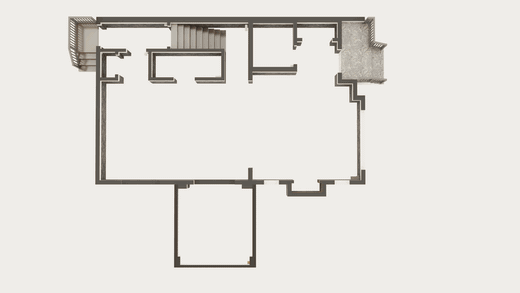
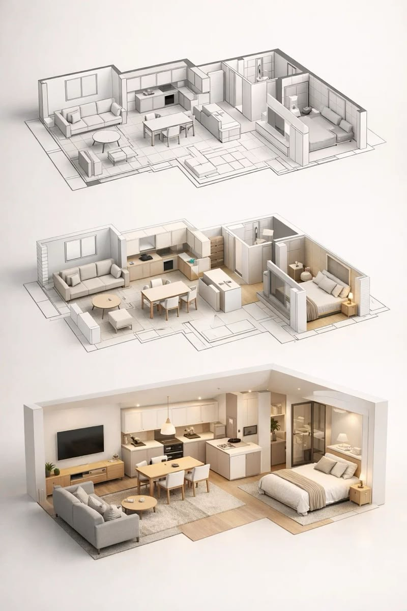

<div align="center">

<a href="public/readme/demo.mp4">
  
</a>

<sub>🎬 <i>From a flat 2D plan to a walkable 3D space. <a href="public/readme/demo.mp4">Watch the full-quality video</a></i></sub>

<br /><br />



<sub><i>Drawing → 3D model → photorealistic render</i></sub>

# Architecture Solutions

### Turn 2D architectural drawings into photorealistic 3D renders, powered by Google Gemini

<p>
  
  
</p>

<p>
  
  
  
  
  
  
  
  
</p>

</div>

---

> [!IMPORTANT]
> **🚧 This project is under active development.**
> I'm building Architecture Solutions right now, and it is **not finished yet**. The foundation is done: the app shell, authentication, design system, and landing page. The core AI rendering pipeline is the part I'm working on now. See the [Roadmap](#-roadmap) for what's done and what's next.

---

## 📖 Table of Contents

- [About the Project](#-about-the-project)
- [How It Works](#-how-it-works)
- [Features](#-features)
- [Tech Stack](#-tech-stack)
- [Project Structure](#-project-structure)
- [Roadmap](#-roadmap)
- [Getting Started](#-getting-started)
- [Deployment](#-deployment)
- [Author](#-author)

---

## 🏛 About the Project

Architects, interior designers, and homeowners often work from **flat 2D floor plans**: CAD exports, scanned blueprints, or hand sketches. These drawings are precise, but most clients find them hard to picture.

**Architecture Solutions** closes that gap. You upload a floor plan image, and the app sends it to **Google Gemini's image model** with a carefully engineered architectural prompt. You get back a **clean, photorealistic 3D visualization** of the same space, with real walls, doors, windows, flooring, and furniture.

The goal is a fast, free SaaS that lets anyone go from **drawing to render in seconds**, with no 3D modelling skills or expensive software.

---

## ⚙️ How It Works

```
┌──────────────┐     ┌──────────────┐     ┌──────────────────┐     ┌──────────────┐
│  01  UPLOAD  │ ──▶ │  02 ANALYZE  │ ──▶ │    03  RENDER    │ ──▶ │  04  EXPORT  │
│              │     │              │     │                  │     │              │
│ Drop a 2D    │     │ AI reads the │     │ Gemini generates │     │ Download or  │
│ floor plan   │     │ walls, rooms │     │ a photorealistic │     │ share your   │
│ (JPG / PNG)  │     │ and fixtures │     │ 3D visualization │     │ render       │
└──────────────┘     └──────────────┘     └──────────────────┘     └──────────────┘
```

The rendering prompt has strict rules so that the output stays faithful to the original drawing:

- **Geometry must match.** Walls, rooms, doors, and windows follow the exact lines of the plan.
- **No text in the output.** Labels, dimensions, and annotations are removed cleanly.
- **Fixture mapping.** Bed, sofa, kitchen, and bathroom icons become realistic furniture.
- **No hallucinated content.** Nothing is added that isn't shown on the plan.
- **Professional finish.** Neutral daylight, realistic materials, and a crisp architectural-viz look.

---

## ✨ Features

| Feature | Description | Status |
|---|---|:---:|
| 🔐 **Authentication** | One-click sign in and sign out with a Puter account, with app-wide auth state | ✅ Done |
| 🎨 **Design System** | Light-first UI with Plus Jakarta Sans, Inter, and JetBrains Mono, based on drawer.ai, sitesyncai.com, and tabpro.ai | ✅ Done |
| 🧭 **Navbar** | Sticky blurred navbar with auth-aware actions | ✅ Done |
| 🖥 **Landing Page** | Hero, interactive "How It Works", feature preview, metrics band, CTA, and footer | 🛠 In progress |
| 📤 **Floor Plan Upload** | Drag-and-drop upload for JPG and PNG files up to 10 MB | 🛠 In progress |
| 🤖 **AI 2D → 3D Rendering** | Gemini image generation (Gemini 2.5 Flash Image) at 1024 × 1024 | 🛠 In progress |
| 🔀 **Before / After Slider** | Compare the source drawing and the AI render side by side | 📋 Planned |
| 🗂 **Project Gallery** | A saved history of your uploads and renders | 📋 Planned |
| ☁️ **Persistent Hosting** | Permanent cloud storage and public URLs for every render | 📋 Planned |
| 🌍 **Community Feed** | Share renders publicly, with privacy controls | 📋 Planned |
| 📥 **Export** | PNG download now, with PDF and shareable links later | 📋 Planned |

---

## 🛠 Tech Stack

| Layer | Technology |
|---|---|
| **Framework** | [React 19](https://react.dev/) + [React Router 7](https://reactrouter.com/) (SSR) |
| **Language** | [TypeScript](https://www.typescriptlang.org/) |
| **Styling** | [Tailwind CSS 4](https://tailwindcss.com/) |
| **Build Tool** | [Vite](https://vitejs.dev/) |
| **AI Model** | [Google Gemini](https://deepmind.google/technologies/gemini/) image generation |
| **Auth / Cloud** | [Puter.js](https://docs.puter.com/) for auth, file storage, KV, and AI access |
| **Icons** | [Lucide React](https://lucide.dev/) |
| **Deployment** | [Docker](https://www.docker.com/) (multi-stage Node 20 Alpine build) |

---

## 📁 Project Structure

```
Architecture-Solutions/
├── app/
│   ├── landing/            # Landing page sections (Hero, HowItWorks, Metrics, CTA, Footer…)
│   ├── routes/             # Route modules (home, landing)
│   ├── app.css             # Global styles and design tokens
│   ├── root.tsx            # App shell and Puter auth context
│   └── routes.ts           # Route configuration
├── components/
│   ├── ui/Button.tsx       # Reusable button component
│   └── Navbar.tsx          # Auth-aware navigation bar
├── lib/
│   └── puter.action.ts     # Puter auth helpers (sign in, sign out, current user)
├── public/                 # Static assets
├── DESIGN-SPEC.md          # Full design specification
├── LANDING-PAGE-PLAN.md    # Landing page build plan
├── Dockerfile              # Production container
└── type.d.ts               # Shared global types
```

---

## 🗺 Roadmap

**Phase 1: Foundation** ✅
- [x] React Router 7 + TypeScript + Tailwind project setup
- [x] Design specification (fonts, palette, layout, components)
- [x] Puter authentication and global auth context
- [x] Navbar and reusable UI components

**Phase 2: Landing Page** 🛠 *(current)*
- [x] Hero section with grid overlay
- [x] Interactive "How It Works" walkthrough
- [x] Metrics band, CTA section, and footer
- [ ] Hero demo video
- [ ] FAQ accordion

**Phase 3: Core AI Pipeline** 🛠 *(next)*
- [ ] Drag-and-drop upload component
- [ ] Gemini 2D → 3D render action with an architectural prompt
- [ ] Visualizer page (`/visualizer/:id`) with a before/after slider
- [ ] Image hosting and project persistence

**Phase 4: Product Polish** 📋
- [ ] Project gallery and community feed
- [ ] Export (PNG, PDF, share link)
- [ ] Pricing tiers (Free, Pro, Enterprise)
- [ ] Onboarding flow, mobile layout, and analytics

---

## 🚀 Getting Started

### Prerequisites

- [Node.js](https://nodejs.org/) 20 or newer
- [npm](https://www.npmjs.com/)
- A free [Puter](https://puter.com/) account for signing in

### Installation

```bash
# Clone the repository
git clone https://github.com/SALIK-JAVID/Architecture-Solutions.git
cd Architecture-Solutions

# Install dependencies
npm install

# Start the dev server
npm run dev
```

The app runs at **http://localhost:5173**.

### Available Scripts

| Command | Description |
|---|---|
| `npm run dev` | Start the development server with HMR |
| `npm run build` | Create a production build |
| `npm run start` | Serve the production build |
| `npm run typecheck` | Generate route types and run the TypeScript compiler |

---

## 🐳 Deployment

```bash
docker build -t architecture-solutions .
docker run -p 3000:3000 architecture-solutions
```

The container runs on any Docker host, such as AWS ECS, Google Cloud Run, Fly.io, or Railway.

---

## 👤 Author

**Salik Javid**

[](https://github.com/SALIK-JAVID)

> 💡 *I'm actively building this project and push updates regularly. Feedback and suggestions are welcome. Feel free to open an issue.*

<div align="center">

---

⭐ **If you find this project interesting, consider giving it a star!** ⭐

</div>
